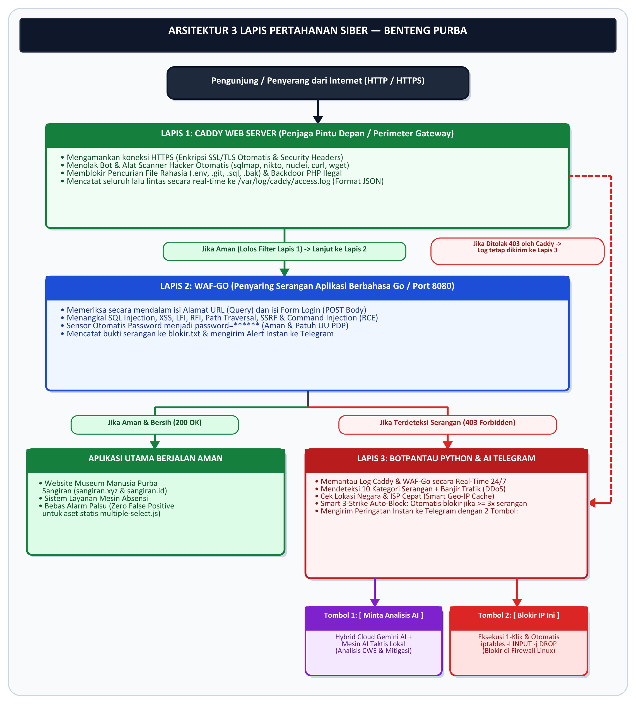

# 🛡️ BENTENG PURBA
**(Benteng Pertahanan Utama dan Responsif Berbasis AI)**  
*Sistem Penangkalan Serangan Web Berlapis dengan Kendali Telegram dan Asisten AI (Berbasis Caddy, WAF-Go, dan Botpantau Python)*

* **Kompetisi:** Kartika Cyber Hackathon 2026 (PUSSIBERAD TNI AD DAN CODEPOLITAN)
* **Kategori:** **PENANGKALAN** (*Active Cyber Defense dan Deterrence*)
* **Studi Kasus Implementasi Nyata:** Infrastruktur Digital dan Layanan Mesin Absensi di Lingkungan **Museum Manusia Purba Sangiran** (`sangiran.xyz` dan `sangiran.id`)

---

## 1. Ringkasan Solusi
**BENTENG PURBA** adalah sistem pertahanan siber aktif 3 lapis (*Defense-in-Depth*) yang berjalan 100% mandiri di dalam server Linux (*on-premise*) tanpa bergantung pada layanan keamanan pihak ketiga. Sistem ini menggabungkan kecepatan penyaringan tingkat aplikasi (**Caddy** dan **WAF-Go**), kecerdasan analisis ancaman (**Hybrid Cloud Google Gemini AI + Local Edge Tactical AI**), serta eksekusi pemutusan akses peretas di level kernel Linux (**`iptables DROP`**) baik secara otomatis (**Smart 3-Strike Auto-Block**) maupun satu sentuhan tombol dari aplikasi **Telegram**.

---

## 2. Arsitektur 3 Lapis Pertahanan



1. **Lapis 1 — Caddy Web Server (`caddy/Caddyfile.example`):**
   * Mengamankan koneksi HTTPS (SSL/TLS otomatis) dan menyuntikkan *Security Headers* (HSTS, CSP, X-Frame-Options).
   * Menolak *scanner* otomatis (`sqlmap`, `nikto`, `nuclei`, `curl`, `wget`) dan memblokir pencurian berkas rahasia (`/.env`, `/.git`, `.sql`, `.bak`) serta *backdoor* PHP ilegal (`403 Forbidden`).
   * Mencatat seluruh lalu lintas ke `/var/log/caddy/access.log` dalam format JSON terstruktur.
2. **Lapis 2 — Custom WAF-Go (`wafgo/main.go`):**
   * *Reverse proxy* berkinerja tinggi berbasis bahasa Go (`:8080`) yang melakukan inspeksi mendalam (*Deep Packet Inspection*) pada parameter URL dan isi *POST Form Body*.
   * Menangkal serangan *SQL Injection (SQLi)*, *Cross-Site Scripting (XSS)*, *LFI/RFI*, *Path Traversal*, *SSRF*, dan *OS Command Injection (RCE)*.
   * **Sensor Password Otomatis (`password=******`):** Menyensor kredensial pada *log* dan notifikasi Telegram demi kepatuhan **UU PDP (UU No. 27 Tahun 2022)**.
3. **Lapis 3 — Botpantau Python dan AI SOC Copilot (`kirimbot/botpantau.py`):**
   * Memantau log secara *real-time* 24/7 dan mendeteksi **10 kategori serangan** (termasuk serangan yang sudah diblokir `403` oleh Caddy di pintu depan) serta lonjakan trafik DDoS.
   * **Smart In-Memory Geo-IP dan ISP Cache:** Mengenali lokasi negara dan provider ISP penyerang dengan latensi 0ms untuk IP berulang.
   * **Smart 3-Strike Auto-Block (Zero False Positive):** Menghitung jumlah pelanggaran per IP. Pada *Strike 1/3* dan *2/3* sistem mengirim peringatan, dan pada **Strike 3/3** sistem **otomatis memblokir IP penyerang di firewall kernel (`iptables -I INPUT -s <IP> -j DROP`)**.
   * **2 Tombol Interaktif di Telegram:**
     * `[ 🧠 Minta Analisis AI ]` : Memanggil **Hybrid AI** (Google Gemini `gemini-flash-latest` dengan *fallback* otomatis ke *Local Edge Tactical AI Engine* anti-gagal) untuk menganalisis jenis serangan (CWE/MITRE), tingkat bahaya, taktik penyerang, dan saran mitigasi.
     * `[ 🔒 Blokir IP Ini ]` : Eksekusi 1-klik `iptables DROP` langsung dari HP Admin.

---

## 3. Struktur Direktori Repository
```text
├── README.md                       # Dokumentasi Utama, Panduan Instalasi dan Deklarasi
├── DIAGRAM_ALUR_BENTENG_PURBA.png  # Diagram Arsitektur 3 Lapis Pertahanan
├── caddy/
│   └── Caddyfile.example           # Konfigurasi Lapis 1 (Caddy Perimeter Gateway)
├── wafgo/
│   ├── main.go                     # Kode Sumber Lapis 2 (Engine WAF-Go)
│   └── templates/
│       ├── waf.html                # Tampilan Halaman Blokir 403 WAF-Go
│       └── log.html                # Template Viewer Log WAF
└── kirimbot/
    ├── botpantau.py                # Kode Sumber Lapis 3 (Botpantau Python dan Hybrid AI)
    ├── config.ini.example          # Contoh Konfigurasi Token Telegram dan Gemini API Key
    └── requirements.txt            # Daftar Dependensi Python
```

---

## 4. Panduan Instalasi (Sesuai Ketentuan Pasal 8.2)

### Prasyarat Sistem
* OS Linux (Ubuntu/Debian/RHEL) dengan akses `root` / `sudo` (untuk eksekusi `iptables`).
* **Caddy Web Server** v2+, **Go** v1.20+, dan **Python** v3.9+.

### Langkah 1: Konfigurasi Lapis 1 (Caddy Web Server)
```bash
sudo cp caddy/Caddyfile.example /etc/caddy/Caddyfile
sudo mkdir -p /var/log/caddy
sudo systemctl restart caddy
```

### Langkah 2: Kompilasi dan Jalankan Lapis 2 (WAF-Go)
```bash
cd wafgo
go build -o main main.go
./main
```
*(WAF-Go akan berjalan dan mendengarkan pada port `:8080`).*

### Langkah 3: Instalasi dan Jalankan Lapis 3 (Botpantau Python)
```bash
cd kirimbot
pip install -r requirements.txt
cp config.ini.example config.ini
nano config.ini   # Isi Token Bot Telegram, ChatID Admin, dan GeminiKey Anda
sudo python3 botpantau.py
```

---

## 5. Cara Penggunaan dan Pengujian (Demo)

1. **Uji Coba Serangan Pencurian File `.env` / SQL Injection:**
   ```bash
   curl -i "https://domain-anda.id/.env"
   curl -i "https://domain-anda.id/login?user=admin'%20union%20select%201,2,3--"
   ```
2. **Respons Sistem:**
   * Akses langsung ditolak dengan status **`HTTP 403 Forbidden`**.
   * Notifikasi peringatan instan masuk ke **Telegram Admin** dilengkapi informasi IP, Negara/ISP, hitungan *Strike (1/3)*, serta 2 tombol interaktif.
3. **Interaksi di Telegram:**
   * Klik **`[ 🧠 Minta Analisis AI ]`** untuk menampilkan hasil analisis ancaman dari AI langsung di bawah pesan.
   * Klik **`[ 🔒 Blokir IP Ini ]`** (atau ulangi serangan hingga 3x untuk memicu *Smart Auto-Block*) untuk memblokir IP penyerang di level kernel (`iptables -L INPUT -v -n`).
4. **Perintah Chat Admin di Telegram:**
   * `/block <ip>` : Blokir IP secara manual di `iptables`.
   * `/unblock <ip>` : Buka blokir IP dari `iptables` dan reset hitungan *Strike* ke `0`.
   * `/block_on` dan `/block_off` : Aktifkan / nonaktifkan *Smart 3-Strike Auto-Block*.

---

## 6. Deklarasi Karya Dasar (*Pre-Existing Work*) — Sesuai Pasal 5.3

Sesuai dengan ketentuan **Pasal 5.3 Syarat dan Ketentuan Kartika Cyber Hackathon 2026**, Tim **BENTENG PURBA** mendeklarasikan secara transparan pemisahan antara fondasi dasar yang telah ada sebelumnya (*pre-existing work*) dengan inovasi dan pengembangan baru yang dikerjakan selama periode program:

| Komponen | Fondasi Sebelum Program (*Pre-Existing Work*) | Pengembangan dan Inovasi Baru Selama Program (*New Development*) |
| :--- | :--- | :--- |
| **1. Caddy Web Server** | Konfigurasi *reverse proxy* dasar untuk meneruskan trafik web dan aplikasi absensi. | Integrasi aturan penolakan pintu depan (`403`) agar terkoneksi dengan sensor deteksi 10 kategori serangan di Lapis 3. |
| **2. WAF-Go (`main.go`)** | Penyaring kata kunci sederhana pada URL yang menampilkan halaman statis. | • **Sensor Password Otomatis (`password=******`)** patuh UU PDP.<br/>• Pengiriman *alert* langsung dari WAF-Go ke Telegram dengan **2 Tombol Interaktif (`Blokir IP` dan `Analisis AI`)**.<br/>• Penambahan aturan deteksi berkas rahasia (`.env`, `.git`, `.htaccess`). |
| **3. Botpantau (`botpantau.py`)** | Skrip pemantau log dasar dengan pemblokiran IP luar negeri berbasis server lokal lama. | • **Hybrid AI Threat Copilot (`[ 🧠 Minta Analisis AI ]`)** menggabungkan Cloud Google Gemini AI + *Local Edge Tactical AI Engine* (100% anti-gagal saat API 503).<br/>• **Smart 3-Strike Auto-Block** (otomatis blokir `iptables DROP` pada serangan ke-3 untuk semua IP tanpa *false positive*).<br/>• **Deteksi 10 Kategori Serangan** termasuk *Scanner User-Agent* (`sqlmap`, `nikto`, `nuclei`) dan *backdoor* PHP.<br/>• **Smart In-Memory Geo-IP dan ISP Cache** (latensi 0ms) dan *Whitelist* aset statis (`multiple-select.js`). |

---

## 7. Atribusi Pustaka dan Komponen Pihak Ketiga — Sesuai Pasal 5.4

Sesuai dengan ketentuan **Pasal 5.4**, berikut adalah daftar perangkat lunak *open-source*, pustaka (*library*), dan layanan API legal yang digunakan dalam **BENTENG PURBA**:
1. **Caddy Web Server** — *Apache License 2.0* (`https://caddyserver.com`)
2. **Go Standard Library (`net/http`, `net/http/httputil`, `regexp`)** — *BSD-3-Clause License* (`https://go.dev`)
3. **Python dan `python-telegram-bot` Library** — *PSF License dan LGPLv3 License* (`https://python-telegram-bot.org`)
4. **Python `requests` Library** — *Apache License 2.0* (`https://requests.readthedocs.io`)
5. **Google Gemini API (`generativelanguage.googleapis.com`)** — *Google APIs Terms of Service* (`https://ai.google.dev`)
6. **IP-API Geo-Location Endpoint (`ip-api.com`)** — *Public Geo-IP Lookup API*
7. **Linux Netfilter `iptables`** — *GNU General Public License v2 (GPLv2)*
